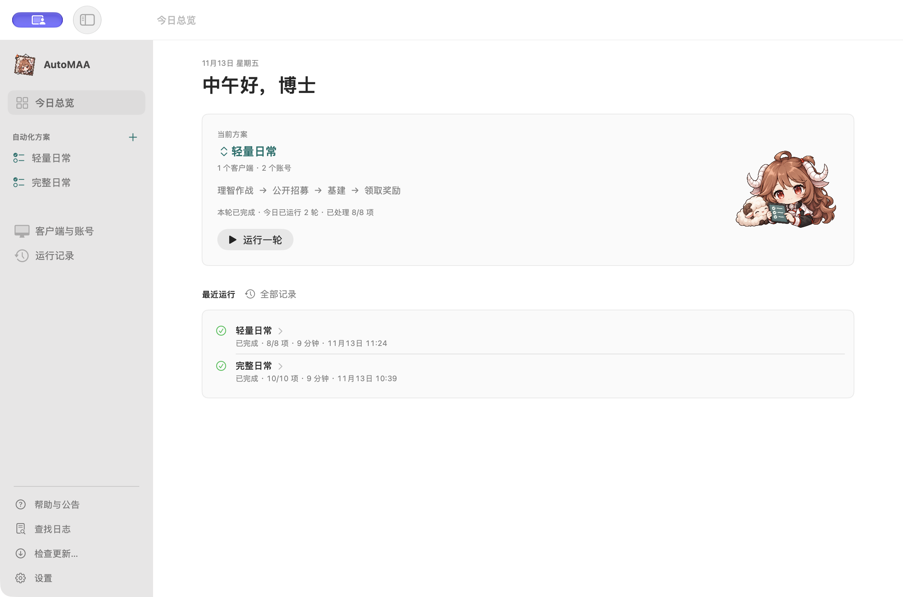
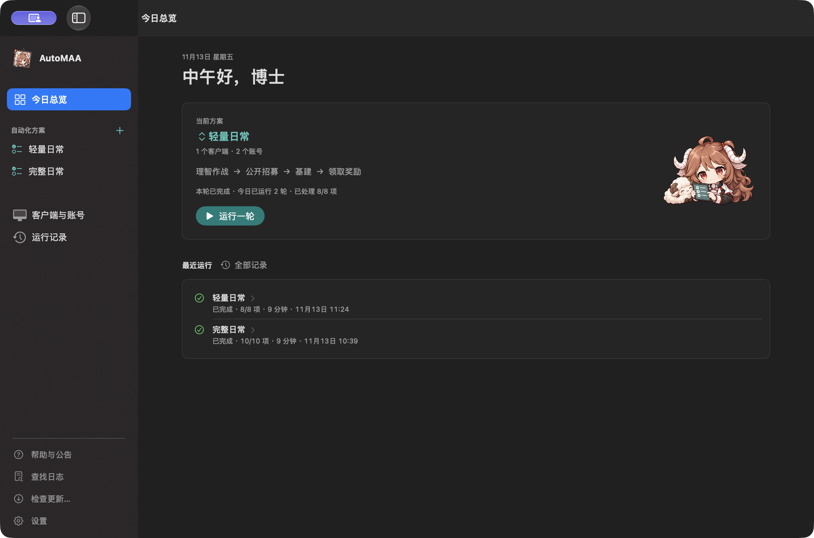
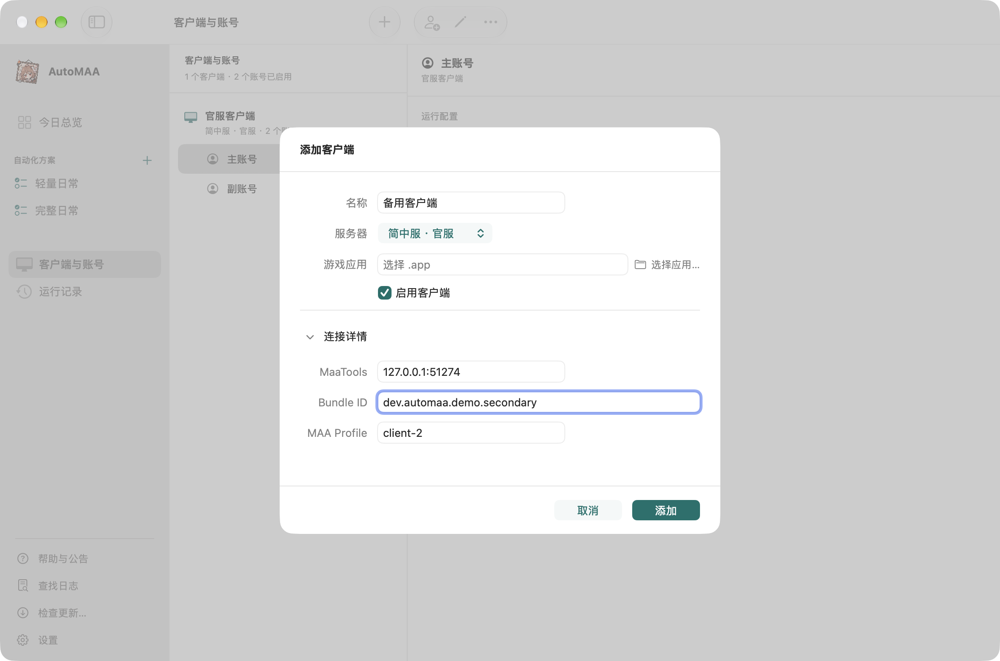
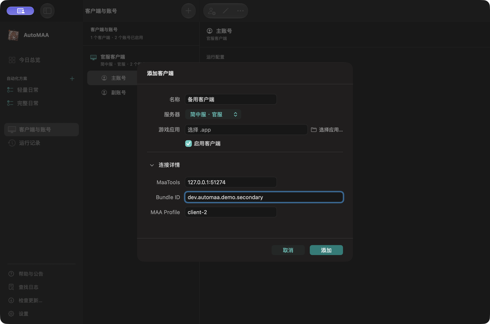

# 首次配置

> 本页跟随主分支，包含尚未发布的执行轮次、通知反馈与软件更新界面调整。截图仍为 v0.16.2，正式版用法见 [v0.16.2 指南](https://github.com/Rememorio/AutoMAA/blob/v0.16.2/docs/guide/getting-started.md)。

先配置一个客户端、一个账号和一个方案，跑通后再扩展账号与定时。可以在尚未安装 MAA 时填写配置；运行前完成[MAA 运行环境安装](./installation)、游戏登录和数据下载。

## 认识主窗口

左侧切换今日总览、自动化方案、客户端与账号、运行记录。选择方案后，中间调整任务顺序，右侧编辑所选任务；右侧顶栏切换“任务设置”与“运行概况”，中列日历图标打开执行安排，详情列左侧播放按钮运行方案。图标悬停时显示操作名称。

任务列表顶部的“执行 N 个账号”表示方案范围，“未设定时”表示尚未开启定时。当前运行状态集中显示在侧栏底部、帮助与公告上方；方案页的停止和播放在顶栏固定成组显示，只改变可用性，不替换图标或文字；客户端与历史记录空闲时不显示运行按钮，后台操作期间提供独立停止入口。工具栏的侧栏按钮或 `Control-Command-S` 可收起、展开导航；方案增多时列表和总览可滚动。

任务行右侧会在运行过程中更新。转圈表示正在执行，绿勾表示全部目标账号均已完成该项，红叉表示失败，灰色斜线表示取消，橙色提醒表示有结果待处理。具体原因可在运行概况中查看。

今日总览以当前方案为主。点击方案名可切换方案，参数与执行安排从左侧对应方案进入。主区显示账号范围、任务顺序、运行入口和进度摘要。运行期间显示实际操作名称和最新消息：游戏任务卡片提供“查看运行”和“安全停止”，独立 MAA 维护只提供“查看维护”，进入 MAA 环境设置后可取消更新。总览顶栏始终保留页面标题与侧栏开关，总体阶段与进度集中在侧栏底部。

“需要处理”和“最近运行”采用同样的分组布局。前者列出待确认结果、作战恢复、配置错误和定时异常，后者保留最近三次方案结果。点击整行即可查看对应详情。“接下来的定时”展示已同步生效的安排，存在待办或已生效定时时才显示对应分区。

<figure class="guide-screenshot">
  
  
  <figcaption>AutoMAA v0.16.2 今日总览。查看当前方案与待处理事项，点击条目回看运行结果。</figcaption>
</figure>

普通操作确认出现在所属窗口内容区右上角，约 6 秒后消失，悬停或键盘聚焦时暂停。需要修正的错误留在相关表单或页面，配置保存失败在工具栏下方提供“重试保存”；提示不会改变窗口尺寸。更新 AutoMAA 可从左下角或应用菜单的“检查更新…”打开独立窗口，更新偏好在“设置 → 通用 → 软件更新”，详见[更新指南](./updates)。

## 检测 MAA 环境

从左下角“设置”或按 `Command-,` 打开独立设置窗口，进入“MAA 环境”，确认 `maa-cli` 路径，点击路径右侧的“检测环境”。应能显示 maa-cli 与 MaaCore 版本；Homebrew 默认路径通常是 `/opt/homebrew/bin/maa`。

检测失败时先[排查环境](../troubleshooting/common#找不到-maa-cli)，无需先添加全部账号。

## 添加客户端

打开侧栏“客户端与账号”，中列按客户端分组显示账号，右侧显示所选对象详情。点击中列顶栏右侧的加号“添加客户端”。在编辑窗口填写：

| 配置 | 如何填写 |
| --- | --- |
| 名称 | 便于辨认的名称，例如“简中服客户端” |
| 服务器 | 与游戏实际服务器一致 |
| 游戏 App | 选择 PlayCover 中对应的游戏 `.app` |
| MaaTools 地址 | 使用游戏窗口显示的地址；本机通常为 `127.0.0.1:1717` |
| MAA Profile | 为每个客户端设置不同的名称，例如 `client-cn`、`client-jp` |
| Bundle Identifier | 与所选游戏 App 一致，用于识别和关闭该客户端 |

<figure class="guide-screenshot">
  
  
  <figcaption>配置表单示意。展开“连接详情”，设置 MaaTools 地址、Bundle ID 与独立 MAA Profile。</figcaption>
</figure>

点击“添加”后选中新客户端并显示详情。客户端按列表顺序执行；选中后点击详情顶栏的铅笔图标编辑名称和连接信息。MAA Profile 是独立的配置标识，必须非空且不能重复。

## 添加账号

在中列选中客户端，再点击详情顶栏的人物加号“添加账号”，填写便于辨认的名称及方案归属，再点击“添加”。保存后选中新账号；铅笔图标编辑当前对象，更多菜单或列表右键菜单提供排序和删除。取消编辑保留原选择，不会创建账号。

能否自动切换账号取决于服务器：

| 服务器 | 账号配置 |
| --- | --- |
| 官服、Bilibili、繁中服 | 支持多个账号 |
| 韩服 | MaaCore v6.16.8 起支持多个账号 |
| 国际服、日服 | 只启用一个账号，使用游戏当前已登录状态 |

只有一个启用账号时，“账号匹配片段”可留空。有多个启用账号时，每个账号都必须填写登录页上非空、唯一的短片段，例如手机号末四位；韩服使用 Email 中可见且不含星号的唯一片段。不要填写密码或完整手机号。

国际服和日服保持片段为空，运行前确认游戏当前登录的是目标账号。第一次多账号运行时，留意登录页是否选中正确账号。AutoMAA 不保存游戏密码，也不会处理验证码。

## 选择日常方案

首次启动提供两个可修改的模板：

| 方案 | 默认任务 |
| --- | --- |
| 轻量日常 | 理智作战 → 公开招募 → 基建仅收菜 → 领取奖励 |
| 完整日常 | 理智作战 → 公开招募 → 基建完整换班 → 信用与购物 → 领取奖励 |

先选择一个模板，确认三件事：

1. **对谁运行**：点击“执行安排…”，选择所有已启用账号或指定账号，再点击“应用”。所有已启用账号会包含以后新增的启用账号。
2. **执行什么**：在任务列表中启用所需任务，直接拖动调整顺序；右键菜单也可上移、下移。任务参数属于方案，同一方案的目标账号共用这些参数。
3. **使用哪些参数**：选择任务后，在右侧参数区选择“MAA 推荐参数”或“自定义参数”，修改自动保存。只收基建产物时，选择自定义参数中的“仅收菜”。

具体选项见[任务配置](../tasks/)。先保持定时关闭，手动确认理智药、源石和购物等消耗设置。

## 运行并确认结果

1. 回到“今日总览”，确认当前方案与执行范围，先处理“需要处理”中的错误；主区若显示“检查配置”或运行提醒，点击查看分组的问题及完整原因。每项标明修复去向，可直接进入 MAA 环境、客户端或对应方案。
2. 确认当前方案、目标账号与任务，点击总览主区的“运行方案”，也可使用方案工具栏的播放按钮。已有当日进度时，正文摘要会说明剩余任务与如何继续；顶部按钮保持原生图标，悬停可查看方案和待办数量；运行时主区显示实际操作名称和最新消息，点击“查看运行”可查看过程与结果。
3. 观察首次账号切换、任务执行和客户端关闭；有多个客户端时，确认下一项在前一项关闭后才启动。
4. 在“运行记录”查看最近一次运行。确认成功步骤、失败原因或需要手动处理的事项；作战汇总可查看实际关卡、次数和掉落。

运行中可点击“安全停止”或按 `Command-.`，等待 MAA 命令结束、游戏关闭和连接释放。总览和方案页播放开启新轮；从“运行记录 → 待办”播放可继续当前轮，跳过本轮已成功步骤，详见[执行流程与续跑](./workflow)。

跑通后，再逐个加入其他客户端或账号，并配置[每周定时运行](./scheduling)。遇到问题可从[常见问题](../troubleshooting/common)开始排查。
