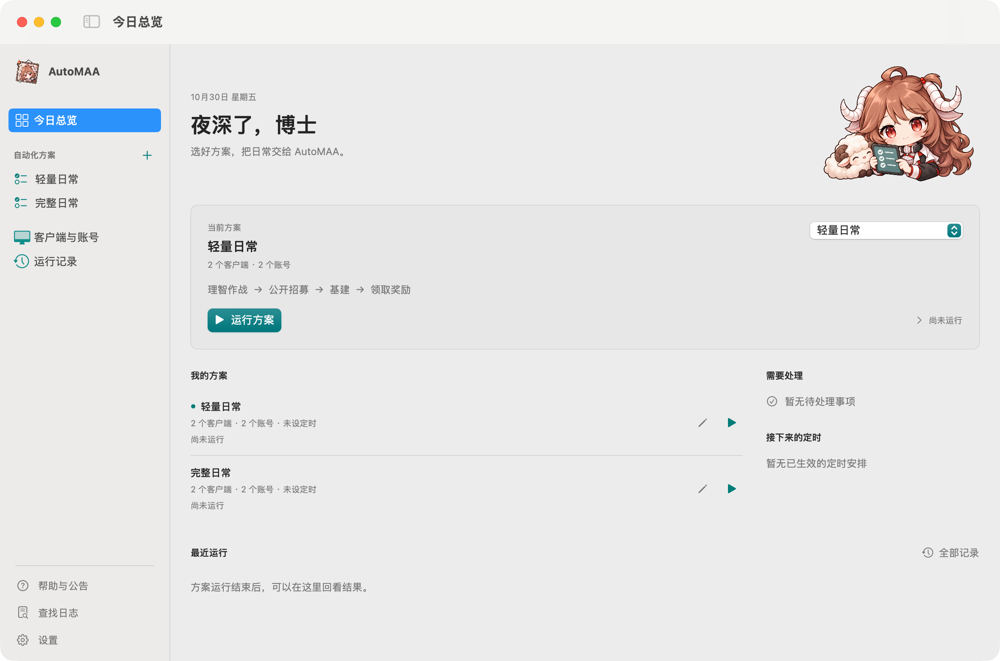
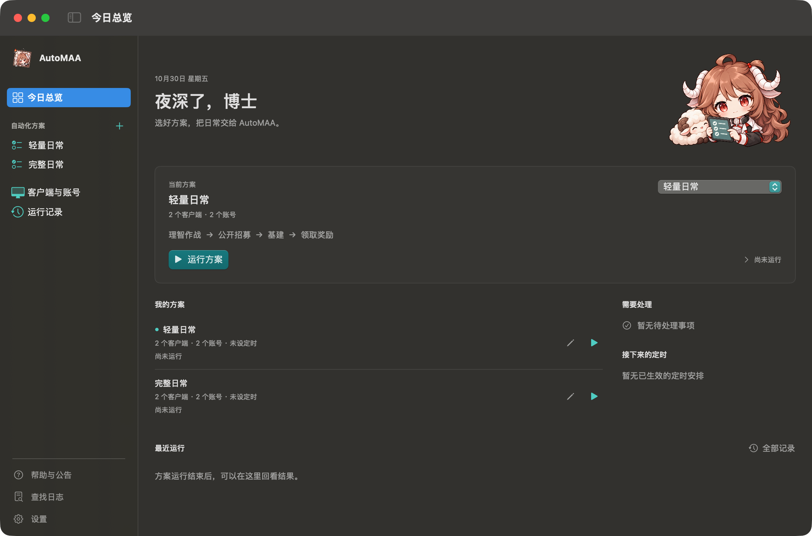

  <section class="home-intro" aria-labelledby="home-title">
    

      <h1 id="home-title">AutoMAA</h1>
      
macOS 上的 MAA 工作流编排器

      
把客户端、账号与任务编成方案， 按顺序运行，随时回看结果。

      

        <a class="home-action home-action-primary" href="./guide/installation">下载与安装→</a>
        <a class="home-action home-action-secondary" href="./guide/getting-started">首次配置→</a>
      

      
Apple Silicon · macOS 14+ 需另装 MAA 与 PlayCover + MaaTools

    

    
  </section>

  <figure class="home-preview">
    
    
    <figcaption>
      

        今日总览 · 方案、进度与待办，一处查看
        <a href="./guide/getting-started#认识主窗口">认识主窗口 →</a>
      

      
以上为 <a href="https://github.com/Rememorio/AutoMAA/releases/tag/v0.16.0-beta.2">v0.16.0-beta.2 预发布版</a>界面。使用正式安装包时，请参阅 <a href="https://github.com/Rememorio/AutoMAA/tree/v0.15.10/docs">v0.15.10 文档</a>。

    </figcaption>
  </figure>

  <section class="home-capabilities" aria-label="核心能力">
    <article>
      <h2>方案配一次，日常重复用</h2>
      
客户端与账号只配置一次。收菜、完整日常、每周剿灭，各有自己的任务与参数。

      <a href="./tasks/">配置任务与参数 →</a>
    </article>
    <article>
      <h2>按顺序运行，按时间开始</h2>
      
客户端依次运行，关闭并释放连接后才切换下一个。每套方案都能单独安排定时。

      <a href="./guide/scheduling">安排每周定时 →</a>
    </article>
    <article>
      <h2>有进度，也有结果</h2>
      
成功步骤按方案保留当日断点。中途可安全停止，结束后查看结果与待处理事项。

      <a href="./guide/workflow">了解执行与续跑 →</a>
    </article>
  </section>

  <nav class="home-resources" aria-label="帮助与项目">
    <a href="./troubleshooting/common">常见问题</a>
    <a href="./development/">参与开发</a>
    <a href="./about/credits">项目关系与致谢</a>
  </nav>

